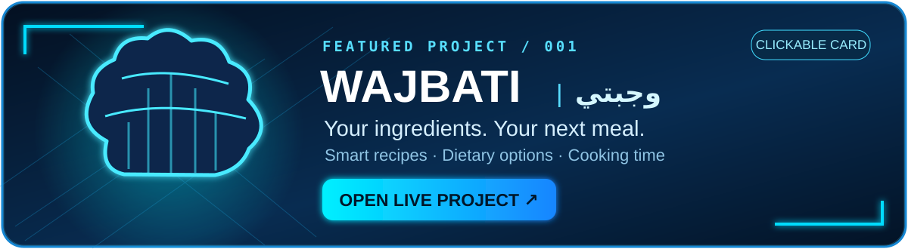
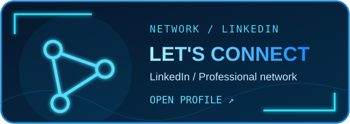

<div align="center">


<br />

**`AI STUDENT`** &nbsp; ✦ &nbsp; **`DEVELOPER`** &nbsp; ✦ &nbsp; **`MAKKAH`**

<a href="https://github.com/Abdailh17"></a>
<a href="https://www.linkedin.com/in/abdullah-badahdah-b726653a7/"></a>
<a href="https://x.com/AbdullahB467"></a>

</div>

---

### `>_ whoami`

**Hey, I'm Abdullah Badahdah.** 👋

Artificial Intelligence student at **Umm Al-Qura University**. I enjoy turning ideas into real software, from Python experiments to full web projects.

`AI & Machine Learning` &nbsp; `Data Analysis` &nbsp; `Web Development`

<details>
<summary>💻 <b>Open developer terminal</b> — real, copyable Python</summary>

```python
class Abdullah:
    name = "Abdullah Badahdah"
    major = "Artificial Intelligence"
    university = "Umm Al-Qura University"
    location = "Makkah, Saudi Arabia"
    skills = ["Python", "OOP", "SQL", "Git", "Web Development"]

    def next_step(self):
        return "Learn. Build. Improve."
```

</details>

### `>_ tech_stack --list`

<div align="center">

<a href="https://www.python.org/"></a>&nbsp;
<a href="https://www.mysql.com/"></a>&nbsp;
<a href="https://git-scm.com/"></a>&nbsp;
<a href="https://github.com/"></a>&nbsp;
<a href="https://code.visualstudio.com/"></a>&nbsp;
<a href="https://developer.mozilla.org/en-US/docs/Web/HTML"></a>

<br />

<sub>Python · SQL / MySQL · Object-Oriented Programming · Web Development · Git & GitHub</sub>

</div>

### `>_ featured_project --open`

<div align="center">

<a href="https://wajbati-sa.vercel.app/"></a>

<a href="https://github.com/Abdailh17/wajbati"></a>

</div>

### `>_ explore --more`

<div align="center">

<a href="https://github.com/Abdailh17?tab=repositories"></a>
<a href="https://www.linkedin.com/in/abdullah-badahdah-b726653a7/"></a>

<br />

<sub>My live contribution calendar is available on <a href="https://github.com/Abdailh17?tab=overview">GitHub Overview</a>. No illustrated activity counts.</sub>

</div>
