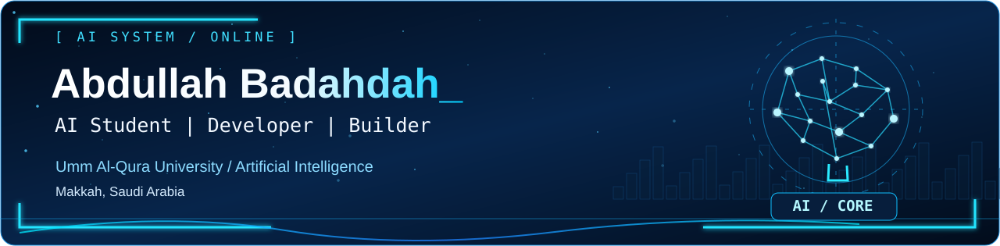
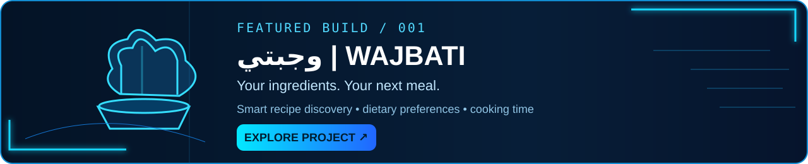

 

### `01 / ABOUT.ME()`

<table>
<tr>
<td width="54%" valign="top">

#### 👋 Hello, World!

I'm **Abdullah Badahdah**, an **Artificial Intelligence** student at **Umm Al-Qura University** in Makkah.

I enjoy building useful projects, exploring AI, and improving my skills by creating real things.

`AI` &nbsp; `Data Analysis` &nbsp; `Web Development`

</td>
<td width="46%" valign="top">

#### `developer.py`

<pre lang="python"><code>class Abdullah:
    major = "Artificial Intelligence"
    university = "UQU"
    location = "Makkah"
    stack = ["Python", "SQL", "Git"]
    goal = "Build useful things"</code></pre>

</td>
</tr>
</table>

### `02 / TOOLKIT.EXE`

 

`Python` &nbsp; `OOP` &nbsp; `SQL` &nbsp; `Web Development` &nbsp; `Data Analysis`

### `03 / FEATURED.BUILD`

### `04 / LIVE.ACTIVITY`

**Explore what I'm building on GitHub**

No static or invented GitHub stats. GitHub displays my current contributions on my profile.

