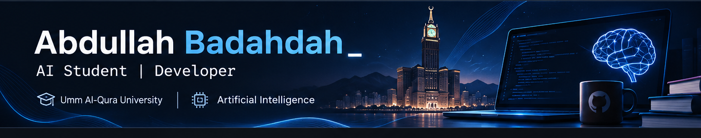

<div align="center">



<br />

`AI STUDENT` &nbsp; ✦ &nbsp; `DEVELOPER` &nbsp; ✦ &nbsp; `MAKKAH`

[](https://github.com/Abdailh17)
[](https://www.linkedin.com/in/abdullah-badahdah-b726653a7/)
[](https://x.com/AbdullahB467)

</div>

---

### `01 / HELLO WORLD` 👋

I'm **Abdullah Badahdah**, an Artificial Intelligence student at **Umm Al-Qura University**. I enjoy exploring AI, learning new technologies, and building useful software.

> **My approach:** `LEARN → BUILD → IMPROVE`

<details>
<summary>⌘ <b>Open my developer terminal</b></summary>

```python
class Abdullah:
    major = "Artificial Intelligence"
    university = "Umm Al-Qura University"
    location = "Makkah, Saudi Arabia"
    skills = ["Python", "OOP", "SQL", "Web Development", "Git"]

    def goal(self):
        return "Turn ideas into useful projects"
```

</details>

### `02 / MY TECH STACK` ⚡

<div align="center">


`Object-Oriented Programming` &nbsp; `SQL` &nbsp; `Web Development` &nbsp; `Data Analysis`

</div>

### `03 / FEATURED PROJECT` 🚀

**🍽️ [وجبتي | WAJBATI](https://wajbati-sa.vercel.app/)**

**Your ingredients, your next meal.** A website that suggests recipes from the ingredients you have, with cooking-time and dietary options.

[](https://wajbati-sa.vercel.app/)
[](https://github.com/Abdailh17/wajbati)

### `04 / ACTIVITY & WHAT'S NEXT` 📈

Currently exploring **AI**, **data analysis**, and **software development**, one project at a time.

[](https://github.com/Abdailh17?tab=overview)
[](https://github.com/Abdailh17?tab=repositories)

<div align="center">

---

<sub>`ABDULLAH.BADAHDAH // END OF FILE`</sub>

</div>
